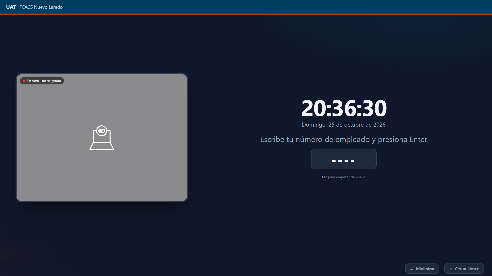
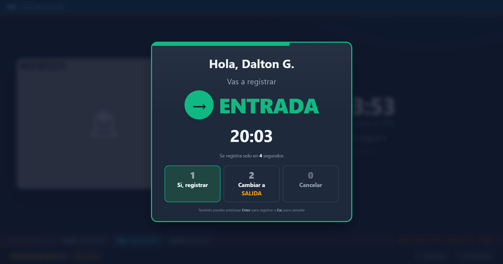
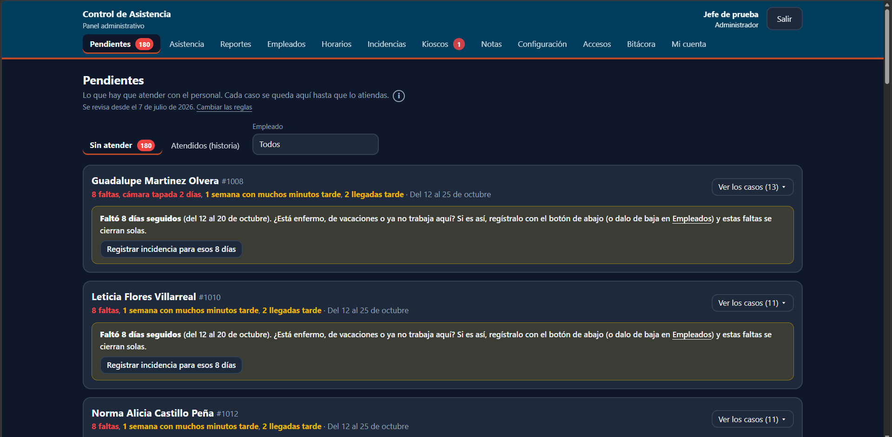
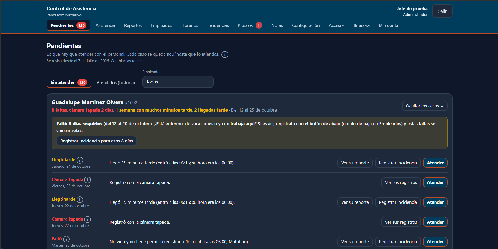
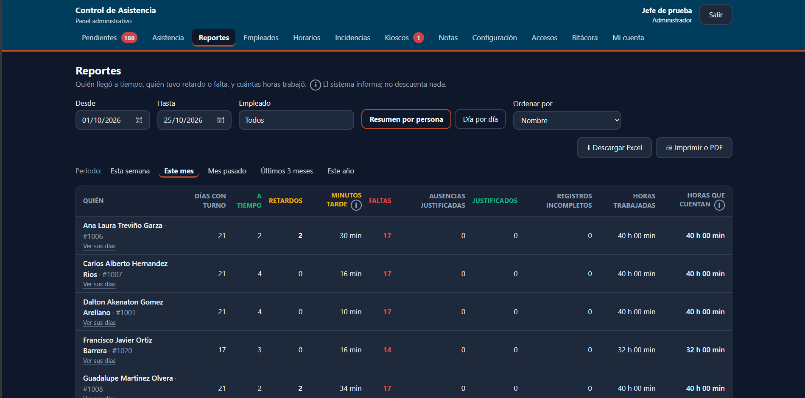
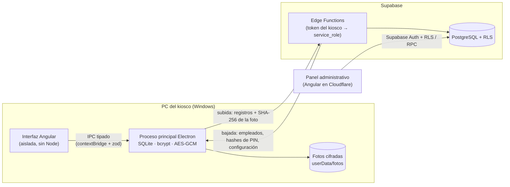

# Kiosco de asistencia sin conexión

**Sistema de control de asistencia desarrollado para una facultad de una
universidad pública en México** (FCACS Nuevo Laredo, UAT), ya instalado y
entregado: un kiosco en Windows
donde el personal de limpieza y los veladores registran su entrada y salida, y
un panel web donde su jefe revisa la asistencia.



---

## El problema

- Alrededor de 20 empleados en tres turnos, incluido un **turno nocturno que
  cruza la medianoche**, en una ciudad fronteriza con **horario de verano**.
- El internet y la luz fallan de vez en cuando. **Nunca se le puede impedir a
  nadie registrar su asistencia**: la red jamás debe bloquear la pantalla.
- El diseño debe prevenir marcajes irregulares e inconsistencias de horario
  (registrar por otra persona, cambiar el reloj de la PC), asumiendo que
  cualquiera tiene acceso físico al kiosco.
- La facultad **no tiene departamento de TI** y las computadoras del kiosco
  cambian con frecuencia. Toda PC debe ser reemplazable, y el sistema debe
  poder mantenerse sólo con su documentación.
- Las fotos de los empleados son datos personales según la ley mexicana; por
  eso el cliente pidió que **las fotos nunca salgan del kiosco**.

## Lo que construí

| Parte | Qué hace |
|---|---|
| **Kiosco** (Electron + Angular) | Cámara en vivo, teclado numérico grande, número de empleado + PIN, foto al validar, sugerencia de ENTRADA/SALIDA con confirmación automática a los 5 s. Funciona 100% sin internet y responde en menos de 1 s. |
| **Modo administrador en el kiosco** | Acceso oculto (mantener presionado), credenciales validadas sin internet, revisión de fotos descifradas **sólo en memoria**, exportación a USB en ZIP con marca de agua, y bitácora de cada consulta. |
| **Nube** (Supabase) | PostgreSQL con RLS en todas las tablas, 30 migraciones versionadas, Edge Functions para el alta de kioscos, la sincronización en ambos sentidos y el latido (heartbeat). |
| **Panel administrativo** (Angular, Cloudflare Workers) | Asistencia con retardos, faltas y tiempo extra calculados en el servidor; bandeja de "Pendientes" por atender; turnos como plantillas con ajustes por persona y por día, e intercambios; registro manual con motivo obligatorio; reseteo de PIN; alta y baja de kioscos; pantalla de configuración; reportes en Excel y PDF; derechos ARCO (exportar y anonimizar). |
| **Operación** (GitHub Actions) | Pruebas automáticas en cada cambio (levantan un Supabase local y prueban esquema, RLS y Edge Functions); publicación de migraciones, funciones y panel; armado del instalador del kiosco con actualización automática; respaldos SQL + CSV dos veces por semana; resumen diario por correo. |

## Capturas

Con datos de demostración (nombres ficticios).

| Kiosco: confirmación de ENTRADA | Panel: Pendientes |
|---|---|
|  |  |
| **Panel: Pendientes, detalle por persona** | **Panel: Reportes** |
|  |  |

## Arquitectura



## Decisiones técnicas para conversar

Las 50 decisiones están documentadas, con su porqué, en
[`docs/decisiones.md`](docs/decisiones.md). Las más interesantes:

1. **Primero sin conexión, con bandeja de salida idempotente.** Cada registro
   recibe un UUID en el kiosco y el servidor inserta con
   `ON CONFLICT DO NOTHING`, así que los reintentos (con espera creciente)
   nunca duplican una marca. Se puede desconectar la PC en cualquier momento
   sin perder datos.
2. **Las fotos se quedan en el kiosco; a la nube sólo va su hash.** Cada JPEG
   se resume con SHA-256 *antes* de cifrarlo con AES-256-GCM. El panel puede
   señalar una foto como *faltante* o *alterada* sin tenerla nunca. Los
   archivos se nombran con el UUID del registro, nunca con el del empleado.
3. **Contraseña de recuperación para la llave de cifrado.** La llave se protege
   con DPAPI de Windows (`safeStorage`), que muere con el perfil de Windows.
   Eso choca con "toda PC es reemplazable", así que la llave también se
   envuelve con una contraseña de recuperación que elige el administrador.
4. **Detección de cambios de reloj sin bloquear jamás.** Cada marca guarda la
   hora del sistema, el reloj monotónico, el identificador del arranque y el
   último desfase conocido con el servidor. Los saltos, los registros
   anteriores al último o las fechas absurdas (pila del BIOS agotada) levantan
   la bandera `reloj_sospechoso` para revisión, en lugar de rechazar el registro.
5. **El kiosco no sabe qué es un retardo.** Sólo registra marcas. Retardos,
   faltas y horas trabajadas se calculan **al consultar**, en el servidor, con
   timestamps, turnos y la configuración vigente. Cambiar la tolerancia
   recalcula el histórico sin tocar un solo registro, que además es inmutable.
6. **Zonas horarias bien hechas.** Todo se guarda en UTC. Los horarios de los
   turnos son locales (`America/Matamoros`, nunca un desfase fijo) y se
   combinan con la *fecha laboral* en el servidor, así que un turno de
   22:00 a 06:00 dura 7 u 9 horas reales en las noches de cambio de horario.
   Esas noches tienen pruebas propias.
7. **Electron endurecido.** `contextIsolation`, `sandbox`, sin
   `nodeIntegration`, CSP estricta, navegación y ventanas nuevas bloqueadas, y
   sólo el permiso de cámara. El preload expone operaciones específicas
   (`registrarMarca`), nunca genéricas, y cada handler de IPC valida su
   entrada con zod.
8. **Nada dentro del `.exe` es de confianza.** El kiosco nunca usa Supabase
   Auth ni consulta tablas: llama Edge Functions con un token propio, obtenido
   con un código de alta de un solo uso que expira en 15 minutos y guardado
   cifrado con DPAPI. El servidor sólo conserva el hash del token. Ningún rol
   puede hacer `UPDATE` ni `DELETE` sobre las marcas: las correcciones son
   filas aparte, con motivo obligatorio.
9. **Las reglas de negocio son datos, no código.** Tolerancias, turnos, días de
   retención, intentos de PIN y demás viven en la tabla `configuracion`, que el
   jefe edita desde el panel. El kiosco guarda una copia para seguir
   funcionando sin internet.
10. **Privacidad desde el diseño.** Sin reconocimiento facial (eso convertiría
    las fotos en datos biométricos sensibles). Las fotos se borran solas a los
    30 días, salvo las que un administrador marca como "Conservar". Los
    derechos ARCO se resuelven con anonimización registrada en bitácora,
    porque los registros son inmutables.

## Tecnologías

**Kiosco:** Electron 44 · Angular 21 (standalone components, signals) ·
Tailwind CSS 4 · SQLite con `node:sqlite` · bcryptjs · zod ·
electron-builder (NSIS) · electron-updater
**Nube:** Supabase (PostgreSQL, RLS, Auth, Edge Functions en Deno, pgcrypto)
**Panel:** Angular 21 · Tailwind CSS 4 · Cloudflare Workers (archivos estáticos)
**Herramientas:** TypeScript estricto · monorepo con npm workspaces · esbuild · GitHub Actions

## Estructura del repositorio

```
apps/kiosco-ui        Interfaz Angular del kiosco (renderer de Electron)
apps/kiosco-main      Proceso principal de Electron + preload, SQLite, cifrado, sincronización
apps/panel            Panel administrativo en Angular
packages/compartido   Configuración, tema y tipos compartidos
supabase/             Migraciones, políticas RLS, Edge Functions y sus pruebas
docs/                 Manual del jefe, manual técnico, guía para empleados y registro de decisiones
```

## Cómo correrlo en local

Requiere Node 24, Docker (para Supabase local) y Windows para el kiosco.

```bash
npm install
npm run supabase:local          # Supabase local con datos de demostración (supabase/seed.sql)
npm run supabase:probar         # pruebas del esquema, RLS y reportes
npm run panel:servir            # panel en http://localhost:4300
npm run kiosco:dev              # kiosco en modo desarrollo
npm run probar                  # pruebas del kiosco (PIN, reloj, cifrado, sincronización)
```

Los workflows de publicación sólo corren si el repositorio tiene la variable
`DESPLIEGUE_ACTIVO` en `true`, y esta copia pública no la tiene. Aquí sólo
corren las pruebas.

## Sobre este repositorio

Es una **copia de portafolio** de un sistema que diseñé y desarrollé para la
Facultad de Comercio, Administración y Ciencias Sociales (UAT, Nuevo Laredo).
La versión instalada en la facultad vive en su repositorio privado. En esta
copia, los identificadores de proyecto, nombres de cuenta, correos y
direcciones se reemplazaron por valores de ejemplo. Los nombres de empleados de
los datos de demostración son ficticios.

Los commits en coautoría con Claude reflejan desarrollo asistido por IA. La
especificación [`ARQUITECTURA.md`](ARQUITECTURA.md) muestra cómo se pusieron por escrito
los requisitos, las reglas de seguridad y las decisiones de diseño para guiar
ese trabajo.

**Autor:** Dalton Akenaton Gómez Arellano · [github.com/DaltonAkenaton](https://github.com/DaltonAkenaton)

Todos los derechos reservados. El código se publica sólo para fines de portafolio y revisión.
