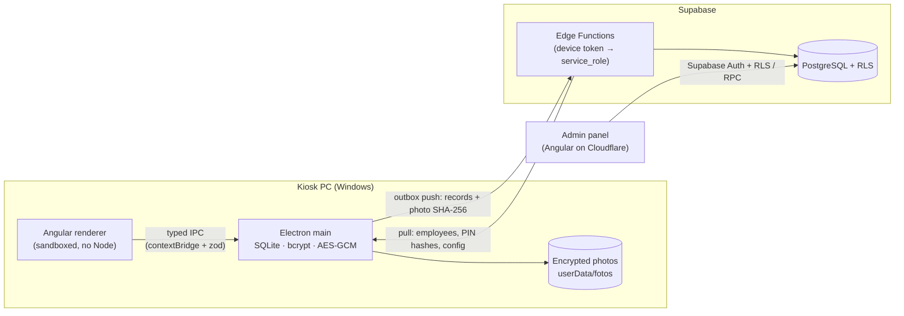

# Offline-first attendance kiosk

**Time-and-attendance system in production at a public university faculty in Mexico**
(FCACS Nuevo Laredo, UAT): a Windows kiosk where cleaning and night-watch staff
clock in and out, plus a web panel where their supervisor reviews attendance.

> 🇲🇽 **Resumen en español:** sistema de control de asistencia para el personal
> de limpieza y veladores de una facultad. Kiosco de escritorio (Electron +
> Angular) que funciona sin internet, toma una foto cifrada como evidencia en
> cada registro y sincroniza con Supabase; panel web (Angular) para el jefe con
> retardos, faltas, pendientes y reportes. En producción desde octubre de 2026.
> Toda la documentación interna está en español en [`docs/`](docs/).

---

## The problem

- ~20 employees across three shifts, including a **night shift that crosses
  midnight**, in a border city with **daylight saving time**.
- Internet and power fail now and then. **Nobody can ever be prevented from
  clocking in**: the network must never block the screen.
- The design must prevent irregular punches and time inconsistencies (proxy
  punching, a changed PC clock), assuming anyone can physically touch the kiosk.
- The faculty has **no IT department**, and kiosk PCs get swapped often. Every
  machine has to be replaceable, and the system has to be maintainable from
  its documentation alone.
- Photos of employees are personal data under Mexican law, so the client asked
  that **photos never leave the kiosk**.

## What I built

| Part | What it does |
|---|---|
| **Kiosk** (Electron + Angular) | Live camera, big numeric keypad, employee number + PIN, photo on success, suggested ENTRY/EXIT with a 5 s auto-confirm. Works 100% offline and responds in < 1 s. |
| **Admin mode in the kiosk** | Hidden entry (long-press), offline-validated admin credentials, photo audit decrypted **in memory only**, watermarked ZIP export to USB, every access logged. |
| **Cloud** (Supabase) | PostgreSQL with RLS on every table, 30 versioned migrations, Edge Functions for device enrollment, push and pull sync, and heartbeat. |
| **Admin panel** (Angular, Cloudflare Workers) | Attendance with lateness/absence/overtime computed server-side, a "Pending" inbox of cases to resolve, shift templates with per-person/per-day overrides and swaps, manual entries with mandatory reasons, PIN resets, device enrollment/revocation, configuration screen, Excel/PDF reports, GDPR-style (ARCO) export and anonymization. |
| **Operations** (GitHub Actions) | CI that boots a local Supabase and runs schema/RLS and Edge Function tests on every push; deploy of migrations, functions and panel; kiosk installer build with auto-update; twice-weekly SQL + CSV backups; daily email summary. |

## Architecture



## Engineering decisions worth discussing

All 50 decisions are written up as ADRs in
[`docs/decisiones.md`](docs/decisiones.md). The most interesting ones:

1. **Offline-first with an idempotent outbox.** Every record gets a UUID on the
   kiosk; the server inserts with `ON CONFLICT DO NOTHING`, so retries with
   exponential backoff can never duplicate a punch. A PC can be unplugged at
   any moment without losing data.
2. **Photos stay on the kiosk; only their hash goes to the cloud.** Each JPEG
   is hashed (SHA-256) *before* AES-256-GCM encryption. The panel can flag a
   photo as *missing* or *tampered* without ever having it. Files are named by
   record UUID, never by employee.
3. **A recovery password for the encryption key.** The key is protected with
   Windows DPAPI (`safeStorage`), which dies with the Windows profile. That
   clashes with "every PC is replaceable", so the key is also wrapped with an
   admin-chosen recovery password.
4. **Clock-tampering detection without ever blocking.** Each punch stores wall
   clock, monotonic clock, boot ID and last known server offset. Jumps, records
   older than the last one, or absurd dates (dead BIOS battery) raise a
   `reloj_sospechoso` flag for review instead of rejecting the punch.
5. **The kiosk doesn't know what "late" means.** It only records punches.
   Lateness, absences and worked hours are computed **at query time** on the
   server, from timestamps, shifts and the current configuration. Changing the
   tolerance recalculates history without touching a single immutable record.
6. **Time zones done properly.** Everything is stored in UTC. Shift times are
   local (`America/Matamoros`, never a fixed offset) and are combined with the
   *work date* on the server, so a 22:00–06:00 shift lasts 7 or 9 real hours
   on DST nights. Those nights have dedicated tests.
7. **Hardened Electron.** `contextIsolation`, `sandbox`, no `nodeIntegration`,
   strict CSP, navigation and new windows blocked, only the camera permission
   allowed. The preload exposes specific operations (`registrarMarca`), never
   generic ones, and every IPC handler validates its input with zod.
8. **Nothing in the `.exe` is trusted.** The kiosk never uses Supabase Auth or
   talks to tables. It calls Edge Functions with a per-device token that it
   got through a one-time, 15-minute enrollment code and stores DPAPI-encrypted.
   The server keeps only the token's hash. There is no `UPDATE` or `DELETE` on
   punches for any role: corrections are separate rows with a mandatory reason.
9. **Business rules are data, not code.** Tolerances, shifts, retention days,
   lockout attempts and similar settings live in a `configuracion` table that the
   supervisor edits from the panel. The kiosk caches it to keep working offline.
10. **Privacy by design.** No facial recognition (that would turn photos into
    sensitive biometric data). Photos are auto-deleted after 30 days unless an
    admin marks them "keep". Data-subject rights are implemented as logged
    anonymization, because records are immutable.

## Tech stack

**Kiosk:** Electron 44 · Angular 21 (standalone components, signals) ·
Tailwind CSS 4 · SQLite via `node:sqlite` · bcryptjs · zod ·
electron-builder (NSIS) · electron-updater
**Cloud:** Supabase (PostgreSQL, RLS, Auth, Deno Edge Functions, pgcrypto)
**Panel:** Angular 21 · Tailwind CSS 4 · Cloudflare Workers (static assets)
**Tooling:** TypeScript (strict) · npm workspaces monorepo · esbuild · GitHub Actions

## Repository layout

```
apps/kiosco-ui        Angular kiosk UI (Electron renderer)
apps/kiosco-main      Electron main process + preload, SQLite, crypto, sync
apps/panel            Angular admin panel
packages/compartido   Shared configuration, theme and types
supabase/             Migrations, RLS policies, Edge Functions and their tests
docs/                 User manual, technical manual, employee guide
docs/curso/           Internal handbook: decisions (ADRs), lessons learned, study guide
```

## Running it locally

Requires Node 24, Docker (for local Supabase) and Windows for the kiosk.

```bash
npm install
npm run supabase:local          # local Supabase with demo data (supabase/seed.sql)
npm run supabase:probar         # schema, RLS and report tests
npm run panel:servir            # admin panel at http://localhost:4200
npm run kiosco:dev              # kiosk in development mode
npm run probar                  # kiosk tests (PIN, clock, encryption, sync)
```

The deploy workflows only run when the repository variable
`DESPLIEGUE_ACTIVO` is `true`, which it is not in this public copy. Only the
test workflow runs here.

## About this repository

This is a **portfolio copy** of a system I designed and built on my own for
the Facultad de Comercio, Administración y Ciencias Sociales (UAT, Nuevo Laredo).
Production runs from the faculty's private repository. In this copy,
project IDs, account names, emails and URLs have been replaced with
placeholders. The employee names in the demo data are fictitious.

Commits co-authored with Claude reflect AI-assisted development. The
[`CLAUDE.md`](CLAUDE.md) specification shows how the requirements, security
rules and client decisions were written down to drive that work.

**Author:** Dalton Akenaton Gómez Arellano · [github.com/DaltonAkenaton](https://github.com/DaltonAkenaton)

All rights reserved. The code is published for portfolio and review purposes only.
